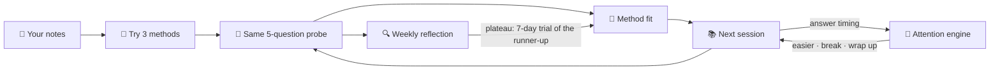

<div align="center">

# 🎯 Attune

**The study coach that finds the method that actually works for you, and notices when it stops working.**

*Attention-aware · evidence-based · built in a day at Great Uni Hack 2026*


[Features](#-features) · [Why it's different](#-why-its-different) · [Quick start](#-quick-start) ·
[Demo](#-demo-in-two-minutes) · [How it works](#-how-it-works) · [Limits](#%EF%B8%8F-honest-limits) · [Team](#-team)

</div>

---

## 💡 What is Attune?

Most study apps hand you one method and a timer. Attune **tries several methods on your own notes, measures which one
teaches you the most per minute, and adapts every session to your attention.** When your progress stalls, an agent
works out *why* (tired, away, or the method stopped working) and runs a small experiment to fix it.

## ✨ Features

| | Feature | What it does |
|---|---|---|
| 🧪 | **Method sampler** | Tries Active Recall, Practice Test and Feynman on similar chunks of your notes and scores each on the same 5-question probe |
| 🎰 | **Adaptive plan** | Picks your next method with Thompson sampling over learning-science priors (Dunlosky et al., 2013); 15% of sessions keep exploring |
| 👀 | **Attention-aware sessions** | Compares answer timing with *your own* baseline, then offers an easier question, a format switch, a break or a wrap-up |
| 🗣️ | **Feynman voice mode** | You explain the topic to "Sam", a curious AI student (ElevenLabs); scored on the key points you covered |
| 🔍 | **Reflection agent** | Tells a plateau from fatigue, low engagement or mastery; rules choose the action, the LLM only explains it |
| 🔬 | **Self-testing plans** | On a plateau it runs a 7-day trial of the runner-up method and keeps it only if scores rise by at least 0.05 |
| 📈 | **Readiness + insights** | Method comparison with uncertainty ranges, scores over time, and a readiness estimate with a confidence label |
| 🧩 | **Support profiles** | Opt-in shorter fixed blocks, reading support and a reading-friendly display, chosen by need and never by diagnosis |

## 🆚 Why it's different

| | Typical study app | Attune |
|---|---|---|
| **Method** | One built in (flashcards, or a Pomodoro timer) | Tests three on *your* material and keeps the one that works |
| **Evidence** | Streaks and time spent | The same 5-question probe after every session, so methods are compared fairly |
| **Focus** | Fixed 25-minute timer | Session length and breaks learned from when *you* start to drift |
| **When you stall** | More reminders | Diagnoses *why* (tired, away, plateau, mastered) and acts on the cause |
| **Changing course** | Manual | Runs a small experiment and adopts the new method only if it wins |
| **AI** | Generates content | Grades and explains; every decision comes from transparent rules |

## 🚀 Quick start

**Requirements:** Python 3.11 and [uv](https://docs.astral.sh/uv/).

```bash
git clone https://github.com/saliha006/Great-Uni-Hack-2026.git && cd Great-Uni-Hack-2026
cp .env.example .env                       # fill in keys (from the team, never committed)
cd backend
uv venv --python 3.11 .venv && uv pip install -r requirements.txt
.venv/bin/uvicorn app.main:app --port 8000 --env-file ../.env   # Windows: .venv/Scripts/uvicorn
```

The API runs at `http://localhost:8000/api`, with interactive docs at `http://localhost:8000/docs`.

| Setting | Values | Use |
|---|---|---|
| `API_MODE` | `real` (default) · `fixtures` | `fixtures` serves canned responses for frontend work |
| `LLM_MODE` | `cache` (default) · `live` · `fixtures` | `cache` calls OpenAI only on a cache miss; `fixtures` never calls it |
| `DATABASE_URL` | default `sqlite:///./attune.db` | point at another database without code changes |

**Tests:** `.venv/bin/python -m pytest tests -q` (run from `backend/`).

## 🎬 Demo in two minutes

All history below is **seeded demo data** for a simulated student, Ada, and is labelled that way in the app.

1. `POST /api/dev/reset`, then `POST /api/dev/seed`: loads Ada's three weeks of study history.
2. `POST /api/dev/advance-days {"days": 7}`: the weekly reflection runs. Ada was tired in week 2, so her sessions were
   shortened and the method kept; in week 3 she plateaued on Practice Test, so Attune starts a 7-day Feynman trial.
3. `POST /api/dev/advance-days {"days": 7}` again: the trial plays out, beats Practice Test, and Attune keeps Feynman.
4. `python scripts/attention_burst.py`: steady answers, then an erratic burst, and Attune suggests a break.

## 🔁 How it works



<details>
<summary><b>📏 How it scores you</b></summary>

- Every session ends with the same 5-question probe (3 multiple choice, 2 short answer) on that session's material, so
  methods are compared on one yardstick.
- Multiple choice is marked exactly. Short answers are marked 0 / ½ / 1 by an LLM against a model answer, with a
  word-overlap fallback. A Feynman explanation scores the share of the passage's key points you covered.
- Method fit is a Bayesian average of those scores, time spent and how the session felt, shown with an "early read"
  range until there is enough data.

</details>

<details>
<summary><b>🔒 Security settings</b></summary>

All optional; with none set the API behaves exactly as above. See `.env.example`.
- `ATTUNE_ENV=prod` removes `/api/dev/*` and the public schema; `DEV_TOKEN` makes dev routes require `X-Dev-Token`.
- `ALLOWED_HOSTS` turns on Host-header checking. uvicorn binds to 127.0.0.1 by default; keep it that way locally.
- `RL_<SCOPE>=count/seconds` sets a rate limit or quota per IP and per user (e.g. `RL_VOICE=20/86400`); unset = unlimited.
- Bodies over 1 MB are rejected, text fields have generous size caps, every response carries `nosniff`/`no-store`
  headers, and API keys are scrubbed from log lines. Keys live only in `.env`, which nothing serves over HTTP.
- An LLM only gets credit for a Feynman key point when its quote really appears in the student's words.

</details>

<details>
<summary><b>👀 How attention is read</b></summary>

- Each answer's time is divided by the time the question should take, then compared over the last 8 answers with your
  own baseline, learned over your first sessions.
- One slow answer is ignored; a run of slow or erratic answers, repeated tab switches or idle gaps count as drifting.
- The state only changes once two readings in a row agree, so it doesn't flicker.

</details>

## 🏗️ Architecture

```
Browser (React)  ──REST──▶  FastAPI backend  ──▶  Engine (pure Python)  ──▶  SQLite
      │                     API, DB, LLM, voice      method fit · attention ·
      └──── voice (signed URL) ────▶ ElevenLabs        diagnosis · reflection · readiness
```

| Layer | Path | Status |
|---|---|---|
| 🖥️ Frontend (React + Vite) | `frontend/` | 🚧 in progress |
| ⚙️ Backend API (FastAPI + SQLModel) | `backend/app/` | ✅ all endpoints live (`/openapi.json`) |
| 🧠 Engine (pure functions, no I/O) | `backend/engine/` | ✅ method fit, attention, diagnosis, reflection, readiness, demo personas |
| 🗄️ Data | SQLite | ✅ local; seeded rows are flagged and labelled |

<details>
<summary><b>📁 Project structure</b></summary>

```
backend/
  app/          FastAPI routes, session flow, database, LLM service, ingestion
  engine/       methodfit · attention · diagnose · agent · predict · simulate · priors · readability
  tests/        app + engine tests (200+)
scripts/        attention_burst.py (live demo helper)
progress.md     team progress log
```

</details>

## ⚠️ Honest limits

- The multi-week history in the demo is **seeded** ("Demo data" in the UI); it is not a real student's data.
- The probe is format-matched to the testing methods and n is tiny per method, so method rankings are an early read.
- Probe scores measure what you knew right after the session, not long-term retention (a delayed probe is designed,
  not shipped). The readiness estimate has not been checked against real exam results.
- LLM marking is not a teacher's marking. The Feynman transcript comes from the browser and is trusted as sent.
- Attention readings come from answer timing and tab focus compared with your own baseline. They are not a diagnosis:
  Attune does not detect, diagnose or treat ADHD or any condition.
- Thresholds are starting values tuned on simulated students, not research-derived.
- Privacy: pasted material is sent to OpenAI for grading and question generation; voice goes to ElevenLabs; attention
  events stay in the local database.

## 👥 Team

| | Who | Built |
|---|---|---|
| ⚙️ | **Saliha** ([@saliha006](https://github.com/saliha006)) | Backend API, LLM + voice services, demo flow |
| 🖥️ | **Maxym** | Frontend + voice UI |
| 🧠 | **Yehor** ([@yehorm14](https://github.com/yehorm14)) | AI/ML engine, data layer, reflection agent |

<div align="center"><sub>Built at Great Uni Hack 2026 · Attune is a study aid, not a medical tool.</sub></div>
