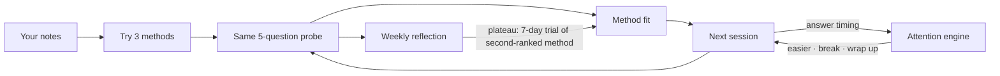

<div align="center">

# Attune

**Attune finds which study method works for you and notices when it stops working.**

*Attention-aware · evidence-based · built in a day at Great Uni Hack 2026*


[Features](#features) · [Why it's different](#why-its-different) · [Quick start](#quick-start) ·
[Demo](#demo-in-two-minutes) · [How it works](#how-it-works) · [Limits](#honest-limits) · [Team](#team)

</div>

---

## What is Attune

Most study apps provide one method and a timer. Attune **tests several methods on your notes, measures learning per
minute, and adapts each session to your attention.** When progress stops improving, an agent identifies the cause
(fatigue, absence, or an ineffective method) and runs a small experiment to address it.

## Features

| Feature | What it does |
|---|---|
| **Method sampler** | Tries Active Recall, Practice Test and Feynman on similar chunks of your notes and scores each on the same 5-question probe |
| **Adaptive plan** | Picks your next method with Thompson sampling over learning-science priors (Dunlosky et al., 2013); 15% of sessions try other methods |
| **Attention-aware sessions** | Compares answer timing with *your own* baseline, then offers an easier question, a format switch, a break or a wrap-up |
| **Feynman voice mode** | You explain the topic to "Sam", a curious AI student (ElevenLabs); it scores the key points you covered |
| **Reflection agent** | Distinguishes a plateau from fatigue, low engagement or mastery; rules choose the action, the LLM explains it |
| **Self-testing plans** | On a plateau it runs a 7-day trial of the second-ranked method and keeps it only if scores rise by at least 0.05 |
| **Readiness + insights** | Method comparison with uncertainty ranges, scores over time, and a readiness estimate with a confidence label |
| **Support profiles** | Opt-in shorter fixed blocks, reading support and a reading-friendly display, chosen by need and never by diagnosis |

## Why it's different

| Aspect | Typical study app | Attune |
|---|---|---|
| **Method** | One built in (flashcards, or a Pomodoro timer) | Tests three on *your* material and keeps the one that works |
| **Evidence** | Streaks and time spent | The same 5-question probe after every session, so methods are compared fairly |
| **Focus** | Fixed 25-minute timer | Learns session length and breaks from when your attention declines |
| **When progress stops** | More reminders | Identifies the cause (tired, away, plateau, mastered) and acts on it |
| **Method changes** | Manual | Runs a small experiment and adopts the new method only if scores improve |
| **AI** | Generates content | Grades and explains; every decision comes from transparent rules |

## Quick start

**Requirements:** Python 3.11 and [uv](https://docs.astral.sh/uv/).

```bash
git clone https://github.com/saliha006/Great-Uni-Hack-2026.git && cd Great-Uni-Hack-2026
cp .env.example .env                       # fill in keys (from the team, never committed)
cd backend
uv venv --python 3.11 .venv && uv pip install -r requirements.txt
.venv/bin/uvicorn app.main:app --port 8000 --env-file ../.env   # Windows: .venv/Scripts/uvicorn
```

The API runs at `http://localhost:8000/api`, with interactive docs at `http://localhost:8000/docs`.

**Frontend** (needs Node 18+), in a second terminal:

```bash
cd frontend && cp .env.example .env && npm install && npm run dev   # http://127.0.0.1:5173
```

Set `VITE_API_URL=http://localhost:8000` in `frontend/.env` to use the backend; left empty, the frontend runs on a
built-in mock API with demo data.

| Setting | Values | Use |
|---|---|---|
| `API_MODE` | `real` (default) · `fixtures` | `fixtures` serves canned responses for frontend work |
| `LLM_MODE` | `cache` (default) · `live` · `fixtures` | `cache` calls OpenAI only on a cache miss; `fixtures` never calls it |
| `DATABASE_URL` | default `sqlite:///./attune.db` | point at another database without code changes |

**Tests:** `.venv/bin/python -m pytest tests -q` (run from `backend/`).

## Demo in two minutes

All history below is **seeded demo data** for a simulated student, Ada. The app labels it as demo data.

1. `POST /api/dev/reset`, then `POST /api/dev/seed`: loads Ada's three weeks of study history.
2. `POST /api/dev/advance-days {"days": 7}`: the weekly reflection runs. Ada was tired in week 2, so her sessions were
   shortened and the method kept; in week 3 she plateaued on Practice Test, so Attune starts a 7-day Feynman trial.
3. `POST /api/dev/advance-days {"days": 7}` again: the trial finishes with higher scores than Practice Test, and Attune keeps Feynman.
4. `python scripts/attention_burst.py`: steady answers, then an erratic burst, and Attune suggests a break.

## How it works



<details>
<summary><b>How it scores you</b></summary>

- Every session ends with the same 5-question probe (3 multiple choice, 2 short answer) on that session's material.
  This gives methods a common scoring basis.
- Attune marks multiple-choice answers exactly. An LLM marks short answers 0 / ½ / 1 against a model answer, with a
  word-overlap fallback. Feynman scores measure the share of the passage's key points you covered.
- Method fit is a Bayesian average of those scores, time spent and how the session felt, shown with a preliminary
  range until there is enough data.

</details>

<details>
<summary><b>Hosting: frontend on Vercel, backend on your laptop</b></summary>

The backend keeps its data in SQLite and some demo state in memory, so it is not serverless-ready; it runs locally.
`vercel.json` deploys only the frontend.
- **Public link, no backend:** leave `VITE_API_URL` unset in Vercel. The app runs on its built-in demo data.
- **Presenting with the real backend:** set `VITE_API_URL=http://localhost:8000` in Vercel and redeploy, put the Vercel
  URL in `CORS_ORIGINS` in your local `.env`, start the backend, and open the Vercel link **on the same laptop**.
  Chrome may ask to allow local network access; allow it. Other people's browsers can't reach your laptop.

</details>

<details>
<summary><b>Security settings</b></summary>

All optional; with none set the API behaves exactly as above. See `.env.example`.
- `ATTUNE_ENV=prod` removes `/api/dev/*` and the public schema; `DEV_TOKEN` makes dev routes require `X-Dev-Token`.
- `ALLOWED_HOSTS` turns on Host-header checking. uvicorn binds to 127.0.0.1 by default; keep it that way locally.
- `RL_<SCOPE>=count/seconds` sets a rate limit or quota per IP and per user (e.g. `RL_VOICE=20/86400`); unset = unlimited.
- Bodies over 1 MB are rejected, text fields have generous size caps, every response carries `nosniff`/`no-store`
  headers, and API keys are scrubbed from log lines. Keys live only in `.env`, which nothing serves over HTTP.
- An LLM only gets credit for a Feynman key point when its quote really appears in the student's words.

</details>

<details>
<summary><b>How attention is measured</b></summary>

- Each answer's time is divided by the time the question should take, then compared over the last 8 answers with your
  own baseline, learned over your first sessions.
- It ignores one slow answer. Repeated slow or erratic answers, tab switches or idle gaps indicate inattention.
- The state changes only after two consecutive readings agree, which prevents rapid state changes.

</details>

## Architecture

```
Browser (React)  ──REST──>  FastAPI backend  ──>  Engine (pure Python)  ──>  SQLite
      │                     API, DB, LLM, voice      method fit · attention ·
      └──── voice (signed URL) ────> ElevenLabs        diagnosis · reflection · readiness
```

| Layer | Path | Status |
|---|---|---|
| Frontend (React + Vite) | `frontend/` | onboarding, home, session, progress, insights and dev pages |
| Backend API (FastAPI + SQLModel) | `backend/app/` | all endpoints live (`/openapi.json`) |
| Engine (pure functions, no I/O) | `backend/engine/` | method fit, attention, diagnosis, reflection, readiness, demo personas |
| Data | SQLite | local; seeded rows are flagged and labelled |

<details>
<summary><b>Project structure</b></summary>

```
backend/
  app/          FastAPI routes, session flow, database, LLM service, ingestion
  engine/       methodfit · attention · diagnose · agent · predict · simulate · priors · readability
  tests/        app + engine tests (200+)
scripts/        attention_burst.py (live demo helper)
progress.md     team progress log
```

</details>

## Honest limits

- The multi-week history in the demo is **seeded** ("Demo data" in the UI); it is not a real student's data.
- The probe format matches the testing methods. Sample sizes per method are very small, so rankings are preliminary.
- Probe scores measure knowledge immediately after a session, not long-term retention. A delayed probe is designed
  but not shipped. The readiness estimate has not been checked against real exam results.
- LLM marking differs from a teacher's marking. The browser supplies the Feynman transcript; Attune trusts it as sent.
- Attention readings come from answer timing and tab focus compared with your own baseline. They are not a diagnosis:
  Attune does not detect, diagnose or treat ADHD or any condition.
- Thresholds are starting values tuned on simulated students, not research-derived.
- Privacy: pasted material is sent to OpenAI for grading and question generation; voice goes to ElevenLabs; attention
  events stay in the local database.

## Team

| Who | Built |
|---|---|
| **Saliha** ([@saliha006](https://github.com/saliha006)) | Backend API, LLM + voice services, demo flow |
| **Maxym** | Frontend + voice UI |
| **Yehor** ([@yehorm14](https://github.com/yehorm14)) | AI/ML engine, data layer, reflection agent |

<div align="center"><sub>Built at Great Uni Hack 2026 · Attune is a study aid, not a medical tool.</sub></div>
